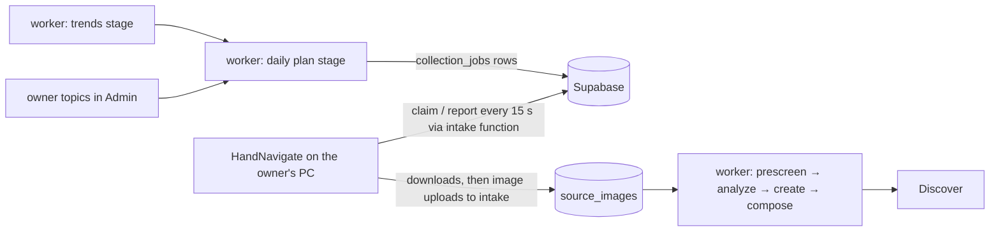

# HandNavigate × StickerDock v2 — plan

## Decision on 6 November: share HandNavigate's Supabase project (supersedes the queue design below)
HandNavigate's new Python agent is already deployed on the owner's Oracle VM. It stores verified Pinterest (and,
once signed in, Reddit) images in Supabase project `kyvowdxtwazxhsdjajpm`: `collection_topics`, `collection_jobs`,
`collection_runs`, `collected_images` and the private `handnavigate-images` bucket (149 images on 5 November). So
StickerDock v2 lives in the **same project**, and the hand-off is a database read:

1. `python -m stickerworker migrate` applies v2's tables. They don't collide with HandNavigate's, and each file
   is applied once.
2. The worker's `library` stage copies new `collected_images` into `source_images`, re-hashing each object first.
   prescreen → analyze → create → compose then make stickers and packs for Discover.
3. The app's Discover feed reads the same project with its publishable key.

| Done (6 Nov) | Where | Checked |
| --- | --- | --- |
| `library` stage, `migrate` command, new `sb_` keys (apikey header only), `.env` loading | stickerlyv2 `main` | worker tests 207/207 |
| Sticker topics (memes, Indian/Hinglish/reaction/Bollywood memes, funny animals), unverified until earned | handNavigation `main` (`migrations/003`) | agent tests 41/41 (2 skipped) |
| Largest `srcset` rendition (Pinterest originals/736x instead of 236 px previews) | handNavigation `main` | browser test with fallback |
| `tools/go-live.ps1`: migrations → one worker run → release APK | stickerlyv2 `main` | parses; needs `.env` |

Waiting on the owner:
- **`.env` values:** the VM's `windows-agent/.env` lines, the publishable key and the Groq keys.
- **Earn the new topics on the VM:** `deploy/free-vm/earn-topics.sh`.
- **Multi-job rotation:** daily jobs for 100 images a day (5 jobs of 20).

The queue design below remains parked on branch `handnavigate-queue`. It is only needed if the two products ever move
to separate Supabase projects.

---

## Earlier plan (paused 2026-11-05)

**Status: paused on the owner's request.** Nothing here is deployed. The pieces already built are parked on branches
(see the table) so `main` only holds finished sticker-app work.

## Goal
About 100 images a day from HandNavigate into v2's Supabase, **on topics v2 chooses** (today's trends plus the
owner's own topics). The AI worker turns them into stickers and packs for Discover.

## What exists today
- **HandNavigate** (`D:\5. GitUploaded\hand`, GitHub `dvajjala-ui/handNavigation`) is a mature browser-automation
  collector: its own logged-in Chrome profiles for Pinterest/Reddit plus Imgflip, Flickr and Openverse recipes, a
  daily image budget, resumable jobs and an authenticated local API. In v1 it polled a job queue outbound (Admin →
  queue → HandNavigate on the owner's PC → v1 `/api/ingest`), so it needed no tunnel.
- **v2 sink** (hand branch `stickerdock-v2-intake`, commit 01ea9e1, local only): every finished download is posted
  to v2's `intake` Edge Function, which stores it as a `source_images` row. This already works with HandNavigate's
  **local** daily plans, whose topics are typed into HandNavigate by hand.
- **v2 intake function** (on `main`): upload → dedup → takedown check → private bucket → `source_images`.

## The gap
v2 can't yet tell HandNavigate *what* to collect. There is no job queue in v2, and HandNavigate listens only on the
PC's loopback address, so the cloud worker (GitHub Actions) can't call it directly.

## Design: a v2 job queue that HandNavigate polls outbound (no tunnel, no open port)

- **Queue:** `collection_jobs` table (topics, sources, image limit, status, progress). `claim_collection_job` hands
  out the oldest job whose sources the collector supports; a job whose collector goes quiet for 15 minutes is
  offered again (HandNavigate keys its local copy on the job id, so it resumes). `report_collection_job` records
  progress and returns `cancel_requested`. Both are service-role only.
- **Transport:** the existing intake function answers `{action:"claim"}` and `{action:"report"}` with the same
  `x-intake-token`, which is exactly what HandNavigate's existing `QueueBridge` sends.
- **HandNavigate:** its v2 sink forwards those calls, so the existing bridge works unchanged when
  `HANDNAVIGATE_CLOUD_QUEUE=1`.
- **Plan:** a worker stage that runs with each cron run but fills each India day only once, up to
  `settings.collect.daily_images` (default 100) in jobs of 25 images × 3 topics.
  - **Topic order:** owner topics, then fresh trends as "<trend> meme", then evergreen searches (chai meme, office
    meme…).
  - **Filters:** no repeats within 3 days; no protected people; no explicit words or slurs.

## Pieces and status

| Piece | Where | Status |
| --- | --- | --- |
| `collection_jobs` + claim/report RPCs (migration `20261105000004`) | `stickerdock-next`, branch `handnavigate-queue` | Built; PGlite tests 5/5 |
| Intake function: `claim` / `report` actions + body validator | same branch | Built; validator tests 3/3; not deployed |
| HandNavigate v2 sink `call()` → claim/report | `hand`, branch `stickerdock-v2-intake` (local) | Built; service tests 43/43, incl. a QueueBridge round trip |
| Worker `plan` stage + `settings.collect` + store methods | `stickerdock-next`, branch `handnavigate-queue` | Drafted; **not tested yet** |
| Admin "Collect" page (queue, progress, cancel, collect now, topics) | — | Not started |

## Remaining steps, in order
1. Worker: tests for the plan stage and the three store methods (LocalStore, Supabase request shapes, dry run).
2. Admin: a Collect page showing jobs and progress, with cancel, "collect now", owner topics and the
   `settings.collect` switch.
3. Owner setup, once the Supabase project exists:
   - Apply migrations 1–4.
   - Deploy `intake` with `INTAKE_TOKEN`.
   - On the PC, set `STICKERDOCK_V2_INTAKE_URL`, `STICKERDOCK_V2_INTAKE_TOKEN`, `HANDNAVIGATE_CLOUD_QUEUE=1` and
     `HANDNAVIGATE_DAILY_LIMIT=100`.
   - Sign in to Pinterest/Reddit in HandNavigate's own profiles.
   - Turn `collect.enabled` on.
4. Qualify one 25-image job end to end (claim → collect → intake → worker → Discover). Then watch 7 days of counts,
   duplicates, login challenges and failures before relying on 100/day.
5. Merge: `stickerdock-next` `handnavigate-queue` → `main`; `hand` `stickerdock-v2-intake` → its main.

## Decisions and risks
- **Integrate, don't rewrite.** HandNavigate already solves the hard parts: browser logins, challenge hand-off to a
  person, budgets, resumable jobs, verified delivery. Rebuilding it in a new folder would cost weeks and
  re-learn those failures. v2 only needs the queue and the sink above. If a separate collector folder is still
  wanted, scope it to API-friendly sources (Flickr, Imgflip, Openverse) and leave logged-in sites to HandNavigate.
- **The PC must stay on, awake and signed in.** Login challenges need a person; they are never solved
  automatically.
- **Source terms.** Pinterest and Reddit restrict reuse, and a download isn't a licence. Discover publishes as found
  with a takedown flow (owner decision); Flickr, Imgflip and Openverse are safer sources to prefer.
- **AI budget.** Groq's free tier analyses about 60 images a day, so 100/day needs prescreen ranking (already in the
  worker) or Groq's paid tier, about $10/month for 100 images a day.
